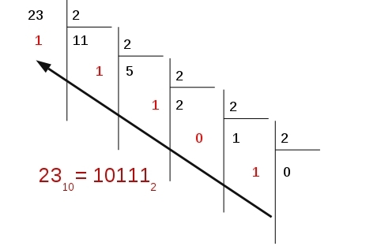
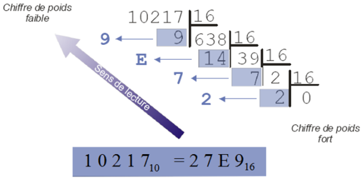
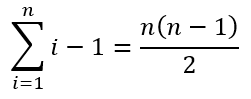
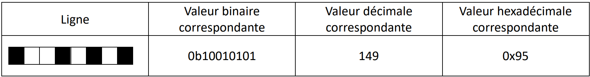
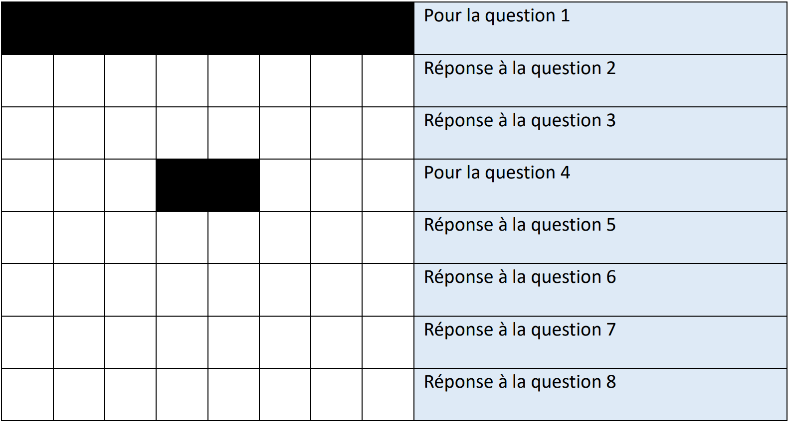

**Table des matières**

1. [Bits et octets](#1-bits-et-octets)
2. [Écrire un entier dans une base](#2-ecrire-un-entier-dans-une-base)
3. [Logique booléenne : tables de vérité et XOR](#3-logique-booleenne-tables-de-verite-et-xor)
4. [Les entiers négatifs : le complément à 2](#4-les-entiers-negatifs-le-complement-a-2)
5. [Les nombres réels : les flottants](#5-les-nombres-reels-les-flottants)
6. [Le texte : de l'ASCII à l'Unicode](#6-le-texte-de-lascii-a-lunicode)
7. [Les images : des pixels et des couleurs](#7-les-images-des-pixels-et-des-couleurs)
8. [À retenir absolument](#8-a-retenir-absolument)

!!! info "🎯 Ce que dit le programme officiel de Première NSI"

    **Représentation des données : types et valeurs de base** — capacités attendues :

    - **Écriture d'un entier positif dans une base b ⩾ 2** : passer de la représentation d'une base dans une autre.
      *Les bases 2, 10 et 16 sont privilégiées.*
    - **Représentation binaire d'un entier relatif** : évaluer le nombre de bits nécessaires à l'écriture en base 2 d'un entier, de la somme ou du produit de deux nombres entiers ; utiliser le **complément à 2**.
      *Il s'agit de décrire les tailles courantes des entiers (8, 16, 32 ou 64 bits). Il est possible d'évoquer la représentation des entiers de taille arbitraire de Python.*
    - **Représentation approximative des nombres réels : notion de nombre flottant** : calculer sur quelques exemples la représentation de nombres réels : 0.1, 0.25 ou 1/3.
      *0.2 + 0.1 n'est pas égal à 0.3. Il faut éviter de tester l'égalité de deux flottants. Aucune connaissance précise de la norme IEEE-754 n'est exigible.*
    - **Valeurs booléennes : 0, 1. Opérateurs booléens : and, or, not. Expressions booléennes** : dresser la table d'une expression booléenne.
      *Le ou exclusif (xor) est évoqué. Quelques applications directes comme l'addition binaire sont présentées. L'attention des élèves est attirée sur le caractère séquentiel de certains opérateurs booléens.*
    - **Représentation d'un texte en machine. Exemples des encodages ASCII, ISO-8859-1, Unicode** : identifier l'intérêt des différents systèmes d'encodage ; convertir un fichier texte dans différents formats d'encodage.
      *Aucune connaissance précise des normes d'encodage n'est exigible.*

---

## <span style="color:#1565C0">1. Bits et octets</span>

!!! abstract "À retenir"
    - Un **bit** (*binary digit*) vaut 0 ou 1 : c'est la plus petite unité d'information.
    - Un **octet** (*byte*, noté `o` ou `B`) = **8 bits**.
    - Avec **n bits**, on peut former **2ⁿ** combinaisons différentes.
      Un octet permet donc 2⁸ = **256** valeurs (de 0 à 255).

| Unité | Symbole | Valeur |
|---|---|---|
| kilooctet | ko | 10³ = 1 000 octets |
| mégaoctet | Mo | 10⁶ = 1 000 000 octets |
| gigaoctet | Go | 10⁹ octets |
| téraoctet | To | 10¹² octets |

!!! warning "Piège : ko ou Kio ?"
    Le **ko** vaut 1 000 octets (préfixe du système international).
    Le **Kio** (kibioctet) vaut 2¹⁰ = **1 024** octets, le **Mio** 2²⁰ = 1 048 576 octets.
    Windows affiche « Ko » mais calcule en Kio : c'est pour ça qu'un disque de « 1 To »
    n'affiche que 931 Go environ.

???+ question "Activité n°1 : Combien de valeurs ?"

    Combien de valeurs différentes peut-on coder avec 4 bits ? avec 16 bits ?

    ??? success "Solution"

        2⁴ = **16** valeurs (de 0 à 15) et 2¹⁶ = **65 536** valeurs.

---

## <span style="color:#1565C0">2. Écrire un entier dans une base</span>

### <span style="color:#2E7D32">2.1 Le principe : la valeur dépend de la position</span>

En base 10, chaque position vaut une **puissance de 10** :

> 185 = 1 × 100 + 8 × 10 + 5 × 1 = 1 × 10² + 8 × 10¹ + 5 × 10⁰

En base 2, c'est exactement pareil avec des **puissances de 2**, et en base 16 avec des **puissances de 16**.

!!! warning "Toujours préciser la base"
    `10` vaut dix en décimal, deux en binaire, seize en hexadécimal !
    On note la base en indice (`1010₂`, `A9₁₆`) ou avec un préfixe :
    `0b1010` pour le binaire, `0xA9` pour l'hexadécimal (notation Python).
    Sans indication, le nombre est en base 10.

### <span style="color:#2E7D32">2.2 Le tableau à connaître par cœur</span>

| Décimal | Binaire | Hexa | | Décimal | Binaire | Hexa |
|---|---|---|---|---|---|---|
| 0 | 0000 | 0 | | 8 | 1000 | 8 |
| 1 | 0001 | 1 | | 9 | 1001 | 9 |
| 2 | 0010 | 2 | | 10 | 1010 | **A** |
| 3 | 0011 | 3 | | 11 | 1011 | **B** |
| 4 | 0100 | 4 | | 12 | 1100 | **C** |
| 5 | 0101 | 5 | | 13 | 1101 | **D** |
| 6 | 0110 | 6 | | 14 | 1110 | **E** |
| 7 | 0111 | 7 | | 15 | 1111 | **F** |

!!! tip "Astuce"
    Les puissances de 2 à connaître : **128 · 64 · 32 · 16 · 8 · 4 · 2 · 1**.
    Avec elles, tu fais toutes les conversions sur un octet de tête.

### <span style="color:#2E7D32">2.3 Binaire → décimal</span>

!!! example "Méthode : additionner les puissances de 2 sous les 1"
    | Puissance | 8 | 4 | 2 | 1 |
    |---|---|---|---|---|
    | Bit | **1** | 0 | **1** | **1** |

    1011₂ = 8 + 2 + 1 = **11**

???+ question "Activité n°2 : Binaire → décimal"

    Écris 1110010₂ en décimal.

    ??? success "Solution"

        | 64 | 32 | 16 | 8 | 4 | 2 | 1 |
        |---|---|---|---|---|---|---|
        | 1 | 1 | 1 | 0 | 0 | 1 | 0 |

        64 + 32 + 16 + 2 = **114**

### <span style="color:#2E7D32">2.4 Décimal → binaire : deux méthodes au choix</span>

!!! example "Méthode 1 : retirer les puissances de 2 (la plus rapide de tête)"
    On veut écrire **57** en binaire. On part de la plus grande puissance de 2 qui « rentre » :

    - 57 − **32** = 25 → bit à 1
    - 25 − **16** = 9 → bit à 1
    - 9 − **8** = 1 → bit à 1
    - 4 et 2 ne rentrent pas dans 1 → bits à 0
    - 1 − **1** = 0 → bit à 1

    | 128 | 64 | 32 | 16 | 8 | 4 | 2 | 1 |
    |---|---|---|---|---|---|---|---|
    | 0 | 0 | 1 | 1 | 1 | 0 | 0 | 1 |

    **57 = 0011 1001₂**

!!! example "Méthode 2 : les divisions successives par 2"
    On divise par 2 jusqu'à obtenir un quotient nul, puis on lit les **restes de bas en haut**.

    

    **23 = 10111₂**

???+ question "Activité n°3 : Décimal → binaire"

    Écris 234 en binaire.

    ??? success "Solution"

        234 − 128 = 106 ; 106 − 64 = 42 ; 42 − 32 = 10 ; 10 − 8 = 2 ; 2 − 2 = 0.

        **234 = 1110 1010₂**

???+ question "Activité n°4 : Les conversions binaires en Python"

    **Tester :**

    ```python
    print(bin(57))           # 0b111001  : décimal → binaire (chaîne de caractères)
    print(int("1011", 2))    # 11        : binaire → décimal
    print(0b1011 + 1)        # 12        : on peut écrire un entier directement en binaire
    print(format(57, "08b")) # 00111001  : binaire sur 8 bits
    ```

    ??? success "Python"
        {{ IDE() }}

    ??? success "Solution"

        **Résultat :**

        ```text
        0b111001
        11
        12
        00111001
        ```

### <span style="color:#2E7D32">2.5 L'hexadécimal (base 16)</span>

!!! info "Pourquoi l'hexadécimal ?"
    Un chiffre hexadécimal correspond **exactement à 4 bits**. Un octet s'écrit donc avec
    **2 chiffres hexa** au lieu de 8 bits : c'est beaucoup plus lisible.
    Tu en croises partout : couleurs web (`#FF8800`), adresses MAC (`3C:22:FB:…`), messages d'erreur.

La base 16 utilise 16 symboles : `0 1 2 3 4 5 6 7 8 9 A B C D E F` (A = 10 … F = 15).

!!! example "Binaire ↔ hexa : on coupe en paquets de 4 bits"
    En partant de la **droite**, on regroupe les bits par 4 (on complète à gauche par des 0) :

    - `1011 1010₂` → `1011` = B, `1010` = A → **BA₁₆**
    - `10 1101₂` → `0010 1101` → **2D₁₆**
    - Dans l'autre sens : `3E₁₆` → `3` = 0011, `E` = 1110 → **0011 1110₂**

!!! example "Hexa → décimal : puissances de 16"
    12B7₁₆ = 1 × 16³ + 2 × 16² + 11 × 16 + 7
    = 4 096 + 512 + 176 + 7 = **4 791**

!!! example "Décimal → hexa : divisions successives par 16"
    Même principe qu'en binaire, en divisant par 16. Un reste de 14 s'écrit E, de 11 s'écrit B…

    

    Restes lus de bas en haut : **10217 = 27E9₁₆**

???+ question "Activité n°5 : Compter en hexadécimal"

    Quel nombre hexadécimal suit FF ? Et 2FFF ?

    ??? success "Solution"

        Comme 99 + 1 = 100 en décimal : **FF + 1 = 100₁₆** (= 256) et **2FFF + 1 = 3000₁₆**.

???+ question "Activité n°6 : Binaire ↔ hexadécimal"

    Écris AB5₁₆ en binaire, puis 1111 0100 1010₂ en hexadécimal.

    ??? success "Solution"

        - A = 1010, B = 1011, 5 = 0101 → **1010 1011 0101₂**
        - 1111 = F, 0100 = 4, 1010 = A → **F4A₁₆**

???+ question "Activité n°7 : L'hexadécimal en Python"

    **Tester :**

    ```python
    print(hex(10217))        # 0x27e9  (Python écrit les lettres en minuscules)
    print(int("12B7", 16))   # 4791
    print(0xFF)              # 255
    ```

    ??? success "Python"
        {{ IDE() }}

    ??? success "Solution"

        **Résultat :**

        ```text
        0x27e9
        4791
        255
        ```

### <span style="color:#2E7D32">2.6 Et dans une base quelconque ?</span>

Même principe dans **n'importe quelle base b** : divisions successives par b pour y aller,
puissances de b pour revenir.



> 58 = 2 × 5² + 1 × 5 + 3, donc **58 = 213₅**

👉 Toutes les méthodes pas à pas sont dans la [📜 Fiche méthode](04d_Codage_de_l_information_fiche.md).

### <span style="color:#2E7D32">2.7 Additionner en binaire</span>

!!! abstract "Les 4 règles"
    0 + 0 = 0 · 0 + 1 = 1 · 1 + 1 = **10** (j'écris 0, je retiens 1) · 1 + 1 + 1 = **11** (j'écris 1, je retiens 1)

```text
retenues   1 1 1 1
             1 1 0 1     (13)
         +   0 1 1 1     ( 7)
         -----------
           1 0 1 0 0     (20)
```

??? tip "Pour aller plus loin : multiplication binaire et addition en hexadécimal"
    **Multiplication** : comme en base 10, mais on ne multiplie que par 0 ou 1, puis on décale.

    ```text
          1 0 1    (5)
        ×   1 1    (3)
        -------
          1 0 1
      + 1 0 1 .
        -------
        1 1 1 1    (15)
    ```

    **Addition en hexadécimal** : dès qu'une colonne dépasse 15, on retient 1.
    Exemple 89₁₆ + C8₁₆ :

    - unités : 9 + 8 = 17 = 16 + **1** → j'écris 1, je retiens 1 ;
    - seizaines : 8 + C (12) + 1 = 21 = 16 + **5** → j'écris 5, je retiens 1 ;
    - la retenue donne le chiffre de gauche : **151₁₆** (= 337).

!!! success "🎞️ Revoir en vidéo"
    [Décimal ↔ binaire](04e_decimal_binaire_video.md) · [Hexadécimal](04f_hexadecimal_video.md)

---

## <span style="color:#1565C0">3. Logique booléenne : tables de vérité et XOR</span>

!!! info "Des bits aux valeurs logiques"
    L'**algèbre de Boole**, développée par **George Boole** (1815-1864), calcule sur deux valeurs :
    `0` représente **FAUX** et `1` représente **VRAI**.
    En Python, ce sont `False` et `True` ; dans un calcul, `True` vaut `1` et `False` vaut `0`
    (`True + True` donne `2`). C'est pourquoi on écrit les tables de vérité avec des `0` et des `1`.

### <span style="color:#2E7D32">3.1 Les trois opérations de base</span>

| Opération | Vraie quand… | Notations | Python |
|---|---|---|---|
| **ET** | les **deux** sont vrais | `a · b`, `a ∧ b` | `a and b` |
| **OU** | **au moins un** est vrai | `a + b`, `a ∨ b` | `a or b` |
| **NON** | `a` est faux | `a̅`, `¬a` | `not a` |

Dans d'autres langages (C, Java, JavaScript), on écrit `&&` pour ET, `||` pour OU et `!` pour NON.

Priorité : **NON**, puis **ET**, puis **OU** (voir le [chapitre 02a](../02_chapitre_2/02a_Les_bases_de_Python.md)) : `A + B · C` se lit `A + (B · C)`.

### <span style="color:#2E7D32">3.2 Les tables de vérité</span>

!!! abstract "À retenir"
    Une **table de vérité** donne la sortie pour **toutes** les combinaisons possibles des entrées.
    Avec **n** entrées, il y a **2ⁿ** lignes (4 lignes pour 2 entrées, 8 pour 3, 16 pour 4),
    écrites dans l'ordre où l'on compte en binaire : `00`, `01`, `10`, `11`…

| A | B | A ET B | A OU B | NON A |
|:-:|:-:|:-:|:-:|:-:|
| 0 | 0 | 0 | 0 | 1 |
| 0 | 1 | 0 | 1 | 1 |
| 1 | 0 | 0 | 1 | 0 |
| 1 | 1 | 1 | 1 | 0 |

**Méthode pour une expression composée :** prévoir **une colonne par calcul intermédiaire**.
Exemple avec `(A ET B) OU (NON A)` :

| A | B | A ET B | NON A | (A ET B) OU (NON A) |
|:-:|:-:|:-:|:-:|:-:|
| 0 | 0 | 0 | 1 | 1 |
| 0 | 1 | 0 | 1 | 1 |
| 1 | 0 | 0 | 0 | 0 |
| 1 | 1 | 1 | 0 | 1 |

???+ question "Activité n°8 : Tables de vérité"

    Dresse les tables de vérité de A · B̅, de A + B · C et de A · B + (C ⊕ D).

    ??? success "Solution"

        **A · B̅**

        | A | B | B̅ | A · B̅ |
        |:-:|:-:|:-:|:-:|
        | 0 | 0 | 1 | 0 |
        | 0 | 1 | 0 | 0 |
        | 1 | 0 | 1 | 1 |
        | 1 | 1 | 0 | 0 |

        **A + B · C** (le ET passe avant le OU)

        | A | B | C | B · C | A + (B · C) |
        |:-:|:-:|:-:|:-:|:-:|
        | 0 | 0 | 0 | 0 | 0 |
        | 0 | 0 | 1 | 0 | 0 |
        | 0 | 1 | 0 | 0 | 0 |
        | 0 | 1 | 1 | 1 | 1 |
        | 1 | 0 | 0 | 0 | 1 |
        | 1 | 0 | 1 | 0 | 1 |
        | 1 | 1 | 0 | 0 | 1 |
        | 1 | 1 | 1 | 1 | 1 |

        **A · B + (C ⊕ D)** (le XOR est défini au 3.3) : 16 lignes. La sortie vaut 1 dès que
        `A = B = 1`, ou bien dès que `C` et `D` sont différents.

        | A | B | C | D | C ⊕ D | A · B | A · B + (C ⊕ D) |
        |:-:|:-:|:-:|:-:|:-:|:-:|:-:|
        | 0 | 0 | 0 | 0 | 0 | 0 | 0 |
        | 0 | 0 | 0 | 1 | 1 | 0 | 1 |
        | 0 | 0 | 1 | 0 | 1 | 0 | 1 |
        | 0 | 0 | 1 | 1 | 0 | 0 | 0 |
        | 0 | 1 | 0 | 0 | 0 | 0 | 0 |
        | 0 | 1 | 0 | 1 | 1 | 0 | 1 |
        | 0 | 1 | 1 | 0 | 1 | 0 | 1 |
        | 0 | 1 | 1 | 1 | 0 | 0 | 0 |
        | 1 | 0 | 0 | 0 | 0 | 0 | 0 |
        | 1 | 0 | 0 | 1 | 1 | 0 | 1 |
        | 1 | 0 | 1 | 0 | 1 | 0 | 1 |
        | 1 | 0 | 1 | 1 | 0 | 0 | 0 |
        | 1 | 1 | 0 | 0 | 0 | 1 | 1 |
        | 1 | 1 | 0 | 1 | 1 | 1 | 1 |
        | 1 | 1 | 1 | 0 | 1 | 1 | 1 |
        | 1 | 1 | 1 | 1 | 0 | 1 | 1 |

???+ question "Activité n°9 : Faire écrire une table de vérité par Python"

    Une double boucle parcourt toutes les combinaisons de deux entrées, dans l'ordre binaire.

    ```python
    def table_et():
        print("a b | a and b")
        for a in (0, 1):
            for b in (0, 1):
                print(a, b, "|", int(a and b))

    table_et()
    ```

    `int(...)` convertit le résultat en `0` ou `1` pour obtenir un affichage homogène.

    ??? success "Python"
        {{ IDE() }}

    ??? success "Solution"

        **Résultat :**

        ```text
        a b | a and b
        0 0 | 0
        0 1 | 0
        1 0 | 0
        1 1 | 1
        ```

???+ question "Activité n°10 : La table de A + B · C en Python"

    Écris une fonction `table_A_ou_B_et_C()` qui affiche la table de vérité de A + B · C.

    ??? success "Python"
        {{ IDE() }}

    ??? success "Solution"

        Trois boucles imbriquées, une par entrée :

        ```python
        def table_A_ou_B_et_C():
            print("A B C | A + B.C")
            for A in (0, 1):
                for B in (0, 1):
                    for C in (0, 1):
                        print(A, B, C, "|", int(A or (B and C)))
        ```

        On retrouve bien la table de l'activité 8.

### <span style="color:#2E7D32">3.3 Le OU exclusif : XOR</span>

Le **OU exclusif**, noté **XOR** ou `⊕`, vaut `1` **si les deux bits sont différents**, et `0` s'ils sont identiques.

| A | B | A OU B | A XOR B |
|:-:|:-:|:-:|:-:|
| 0 | 0 | 0 | 0 |
| 0 | 1 | 1 | 1 |
| 1 | 0 | 1 | 1 |
| 1 | 1 | **1** | **0** |

!!! warning "Piège : OU ou XOR ?"
    `1 OU 1 = 1`, mais `1 XOR 1 = 0`. Le XOR, c'est « l'un **ou** l'autre, **mais pas les deux** ».
    Avec les trois opérations de base : `A ⊕ B = A · B̅ + A̅ · B`.

???+ question "Activité n°11 : Le XOR en Python"

    **Tester :**

    `^` est le **XOR bit à bit** : il fonctionne sur `0` et `1`, et sur des entiers bit par bit.
    Pour des booléens, on peut aussi écrire `a != b`.

    ```python
    print(0 ^ 0, 0 ^ 1, 1 ^ 0, 1 ^ 1)   # 0 1 1 0
    print(True != True)                 # False
    ```

    ??? success "Python"
        {{ IDE() }}

    ??? success "Solution"

        **Résultat :**

        ```text
        0 1 1 0
        False
        ```

???+ question "Activité n°12 : Calculer des XOR"

    Calcule `1 XOR 0`, `0 XOR 0` et `1 XOR 1`, puis vérifie avec `^`.

    ??? success "Python"
        {{ IDE() }}

    ??? success "Solution"

        `1 XOR 0 = 1`, `0 XOR 0 = 0`, `1 XOR 1 = 0` : `print(1 ^ 0, 0 ^ 0, 1 ^ 1)` affiche `1 0 0`.


???+ question "Activité n°12bis : Tables de vérité"

    Dresse la table de vérité de  A · B + (C ⊕ D).

    ??? success "Solution"


        **A · B + (C ⊕ D)**  : 16 lignes. La sortie vaut 1 dès que
        `A = B = 1`, ou bien dès que `C` et `D` sont différents.

        | A | B | C | D | C ⊕ D | A · B | A · B + (C ⊕ D) |
        |:-:|:-:|:-:|:-:|:-:|:-:|:-:|
        | 0 | 0 | 0 | 0 | 0 | 0 | 0 |
        | 0 | 0 | 0 | 1 | 1 | 0 | 1 |
        | 0 | 0 | 1 | 0 | 1 | 0 | 1 |
        | 0 | 0 | 1 | 1 | 0 | 0 | 0 |
        | 0 | 1 | 0 | 0 | 0 | 0 | 0 |
        | 0 | 1 | 0 | 1 | 1 | 0 | 1 |
        | 0 | 1 | 1 | 0 | 1 | 0 | 1 |
        | 0 | 1 | 1 | 1 | 0 | 0 | 0 |
        | 1 | 0 | 0 | 0 | 0 | 0 | 0 |
        | 1 | 0 | 0 | 1 | 1 | 0 | 1 |
        | 1 | 0 | 1 | 0 | 1 | 0 | 1 |
        | 1 | 0 | 1 | 1 | 0 | 0 | 0 |
        | 1 | 1 | 0 | 0 | 0 | 1 | 1 |
        | 1 | 1 | 0 | 1 | 1 | 1 | 1 |
        | 1 | 1 | 1 | 0 | 1 | 1 | 1 |
        | 1 | 1 | 1 | 1 | 0 | 1 | 1 |

### <span style="color:#2E7D32">3.4 Application : additionner deux bits</span>

On retrouve l'addition binaire du 2.7. Pour additionner deux bits `A` et `B` :

- le **bit de somme** est `S = A XOR B` ;
- la **retenue** est `R = A ET B`.

| A | B | Retenue R | Somme S | A + B en binaire |
|:-:|:-:|:-:|:-:|:-:|
| 0 | 0 | 0 | 0 | `00` |
| 0 | 1 | 0 | 1 | `01` |
| 1 | 0 | 0 | 1 | `01` |
| 1 | 1 | 1 | 0 | `10` |

Ainsi `1 + 1 = 10₂` : j'écris `0` (le XOR), je retiens `1` (le ET).
Ce petit calcul s'appelle un **demi-additionneur** : on le construira avec des portes logiques au [chapitre 13](../13_chapitre_13/13_Archi_ordinateur.md).

???+ question "Activité n°13 : Additionner deux bits en Python"

    **Tester :**

    ```python
    for a in (0, 1):
        for b in (0, 1):
            print(a, "+", b, "→ retenue", a & b, "somme", a ^ b)
    ```

    (`&` est le ET bit à bit, comme `^` est le XOR bit à bit.)

    ??? success "Python"
        {{ IDE() }}

    ??? success "Solution"

        **Résultat :**

        ```text
        0 + 0 → retenue 0 somme 0
        0 + 1 → retenue 0 somme 1
        1 + 0 → retenue 0 somme 1
        1 + 1 → retenue 1 somme 0
        ```

### <span style="color:#2E7D32">3.5 Les lois de De Morgan</span>

!!! abstract "À retenir"
    - `NON (A OU B) = (NON A) ET (NON B)`
    - `NON (A ET B) = (NON A) OU (NON B)`

    En Python : `not (a or b) == (not a and not b)` et `not (a and b) == (not a or not b)`.
    Elles permettent de « faire entrer » une négation dans une parenthèse, en échangeant ET et OU.

Deux expressions sont **équivalentes** quand elles ont **la même table de vérité** : pour le prouver, on compare **toutes** les lignes.

???+ question "Activité n°14 : Vérifier les lois de De Morgan avec Python"

    **Tester :**

    ```python
    def de_morgan_1(a, b):
        return (not (a or b)) == (not a and not b)

    def de_morgan_2(a, b):
        return (not (a and b)) == (not a or not b)

    for a in (False, True):
        for b in (False, True):
            print(a, b, de_morgan_1(a, b), de_morgan_2(a, b))
    ```

    1. Les deux lois sont-elles vraies pour toutes les combinaisons ?
    2. Retire les parenthèses autour de `not (a or b)` dans `de_morgan_1` et réexécute. Le résultat est toujours `True`… mais pour une mauvaise raison ! Pourquoi ?

    ??? success "Python"
        {{ IDE() }}

    ??? success "Solution"

        1. Oui : la fonction renvoie `True` pour les quatre combinaisons, donc sur **toute** la table de vérité.
        2. `not` est **moins prioritaire** que `==`. Sans parenthèses, Python lit `not ((a or b) == (not a and not b))`. Or `a or b` et `not a and not b` sont toujours contraires, donc la comparaison vaut toujours `False`, et `not False` donne `True` : le programme ne vérifie plus du tout la loi.

### <span style="color:#2E7D32">3.6 Pour la Terminale : XOR et chiffrement</span>

Le XOR a une propriété remarquable : appliqué **deux fois avec la même valeur**, il redonne la valeur de départ.

!!! abstract "À retenir"
    `(A XOR K) XOR K = A`, car `K XOR K = 0` et `A XOR 0 = A`.

```text
Message M : 1 0 1 1
Clé K     : 0 1 1 0
            ------- XOR
Chiffré C : 1 1 0 1
Clé K     : 0 1 1 0
            ------- XOR
Message M : 1 0 1 1
```

???+ question "Activité n°15 : Chiffrer et déchiffrer avec le XOR"

    **Tester :**

    ```python
    message = 0b10110110
    cle = 0b01101001
    chiffre = message ^ cle
    dechiffre = chiffre ^ cle
    print(bin(chiffre), bin(dechiffre), dechiffre == message)
    ```

    ??? success "Python"
        {{ IDE() }}

    ??? success "Solution"

        **Résultat :**

        ```text
        0b11011111 0b10110110 True
        ```

!!! tip "Lien avec la Terminale"
    Cette propriété est le **principe** du chiffrement symétrique étudié en Terminale : on chiffre et on déchiffre avec la **même clé**.
    Attention : ce n'est qu'une **illustration**. Réutiliser la même clé courte pour tout un message n'est pas sûr.

???+ question "Activité n°16 : Chiffrer à la main"

    M = 1101 et K = 1010. Calcule C = M XOR K, puis C XOR K. Que constates-tu ?

    ??? success "Solution"

        `C = 1101 XOR 1010 = 0111`, puis `C XOR K = 0111 XOR 1010 = 1101` : on retrouve **M**.

!!! success "🎞️ Revoir en vidéo"
    [ET, OU, NON](../02_chapitre_2/02k_et_ou_non_video.md) · [Table de vérité](04l_Table_de_verite_video.md) · [XOR, NAND, NOR](04m_xor_nand_nor_video.md) · [Les booléens](04n_Les_booleens_video.md) · [📜 Fiche méthode : booléens et circuits](../13_chapitre_13/13i_Booleens_circuits_fiche.md)

!!! example "🧠 Exercices dans Capytale => le code vous sera donné par votre enseignant"

!!! abstract "Exercice 11 ★ : Tables de vérité"

    1. Complète, **à la main**, la table de vérité de l'expression `(A or B) and (not A)`, avec les colonnes intermédiaires. Par quelle expression plus simple peut-on la remplacer ?
    2. Écris une fonction `table_3(f)` qui affiche la table de vérité d'une fonction `f(A, B, C)` à **trois** entrées (8 lignes, dans l'ordre binaire). Utilise-la pour afficher la table de `A or B and C`.
    3. Dans la table obtenue, combien de lignes donnent `S = 1` ? Pourquoi `A or B and C` ne se lit-il **pas** `(A or B) and C` ?

!!! abstract "Exercice 12 ★ : Le OU exclusif (XOR)"

    1. Quelle différence y a-t-il entre `A or B` et `A XOR B` lorsque `A = B = 1` ? Calcule `1 XOR 0`, `0 XOR 0` et `1 XOR 1`.
    2. Écris une fonction `xor(a, b)` qui renvoie le XOR de deux bits (`0` ou `1`) **sans utiliser** l'opérateur `^` ni `!=` : seulement `and`, `or`, `not`.

!!! abstract "Exercice 13 ★★ : Additionner deux bits"

    Quand on additionne deux bits `a` et `b`, on obtient un **bit de somme** et une **retenue** : `1 + 1 = 10₂` (j'écris 0, je retiens 1).

    1. Complète la table ci-dessous, puis indique quelle opération donne la somme et quelle opération donne la retenue.

        | a | b | retenue | somme |
        |:-:|:-:|:-:|:-:|
        | 0 | 0 | | |
        | 0 | 1 | | |
        | 1 | 0 | | |
        | 1 | 1 | | |

    2. Écris une fonction `demi_additionneur(a, b)` qui renvoie le couple `(retenue, somme)`. Tu peux réutiliser `xor`.
    3. Pourquoi le résultat de `1 + 1` nécessite-t-il **deux** bits ?

!!! abstract "Exercice 14 ★★ : XOR et chiffrement (facultatif)"

    On considère le message `M = 1101` et la clé `K = 1010`.

    1. Calcule **à la main**, bit par bit, `C = M XOR K`, puis `C XOR K`. Que constates-tu ?
    2. Explique pourquoi `(A XOR K) XOR K = A` pour n'importe quel bit `A` et n'importe quelle clé `K`.
    3. **Bonus** : écris une fonction `chiffrer(texte, cle)` qui renvoie le texte obtenu en remplaçant chaque caractère `c` par `chr(ord(c) ^ cle)`. Vérifie qu'appliquer deux fois `chiffrer` avec la même clé redonne le texte de départ.

---

## <span style="color:#1565C0">4. Les entiers négatifs : le complément à 2</span>

!!! question "Pourquoi ne pas simplement réserver un bit pour le signe ?"
    Essayons : 1 bit de signe (0 = +, 1 = −) puis la valeur sur 7 bits.

    - +1 = `0000 0001` et −1 = `1000 0001`
    - +1 + (−1) = `1000 0010`… soit **−2** au lieu de 0 ! 😱

    En plus, zéro aurait deux écritures (+0 et −0). Il faut une meilleure idée : le **complément à 2**.

!!! abstract "Méthode : coder −N sur 8 bits"
    1. Écrire **N** (la valeur positive) en binaire **sur 8 bits**.
    2. **Inverser** tous les bits (0 ↔ 1).
    3. **Ajouter 1**.

!!! example "Exemple : −9"
    ```text
    9 sur 8 bits   : 0000 1001
    inversion      : 1111 0110
    + 1            : 1111 0111   ← −9 en complément à 2
    ```

!!! success "Et ça marche ! Vérifions 27 + (−9) = 18"
    ```text
         0001 1011   (27)
       + 1111 0111   (−9)
       -----------
       1 0001 0010   → on ne garde que 8 bits : 0001 0010 = 18 ✔
    ```
    La retenue qui « déborde » à gauche est simplement perdue.

!!! abstract "À retenir"
    - Le bit de **gauche** (bit de poids fort) indique le signe : **0 = positif**, **1 = négatif**.
    - Sur 8 bits, on code les entiers de **−128 à 127**. Sur n bits : de −2ⁿ⁻¹ à 2ⁿ⁻¹ − 1.

!!! tip "Astuce : lire un binaire négatif en 2 secondes"
    Si le bit de gauche vaut 1, lis le nombre comme un entier positif, puis **retire 256** (sur 8 bits).

    `1111 0111` = 247 → 247 − 256 = **−9**

    (La méthode « inverser + ajouter 1 » marche aussi dans ce sens : 0000 1000 + 1 = 0000 1001 = 9, donc −9.)

???+ question "Activité n°17 : Coder des entiers négatifs"

    Code −36 et −75 sur 8 bits en complément à 2.

    ??? success "Solution"

        - 36 = 0010 0100 → inversion 1101 1011 → +1 → **1101 1100**
        - 75 = 0100 1011 → inversion 1011 0100 → +1 → **1011 0101**

???+ question "Activité n°18 : Décoder des octets signés"

    En complément à 2 sur 8 bits, que valent 1111 1111, 1000 0000 et 0111 1111 ?

    ??? success "Solution"

        - 1111 1111 = 255 − 256 = **−1**
        - 1000 0000 = 128 − 256 = **−128** (le plus petit)
        - 0111 1111 commence par 0 : **127** (le plus grand)

???+ question "Activité n°19 : Le complément à 2 en Python"

    **Tester :**

    ```python
    print(format(-9 % 256, "08b"))   # 11110111 : −9 en complément à 2 sur 8 bits

    def lire_signe(octet):
        """Renvoie la valeur d'un octet écrit en complément à 2."""
        valeur = int(octet, 2)
        if octet[0] == "1":
            return valeur - 256
        return valeur

    print(lire_signe("11110111"))   # -9
    ```

    ??? success "Python"
        {{ IDE() }}

    ??? success "Solution"

        **Résultat :**

        ```text
        11110111
        -9
        ```

!!! success "🎞️ Revoir en vidéo"
    [Complément à 2](04g_complement_video.md) · [Addition en complément à 2](04h_addittion_video.md)

!!! example "🧠 Exercices dans Capytale => le code vous sera donné par votre enseignant"

!!! abstract "Exercice 1 ★ : Addition binaire"

    On code les entiers sur **un octet**.

    1. Donne la représentation binaire de 12, 100 et 88.
    2. Pose l'**addition binaire** de ces trois nombres (avec les retenues), puis vérifie en décimal.

!!! abstract "Exercice 2 ★ : Complément à 2"

    Sur un octet, donne les compléments à 2 de **−12**, **−100** et **−88**.
    Utilise la méthode « inverser + 1 » pour l'un et la méthode « 256 − n » pour un autre : tu dois trouver la même chose !

!!! abstract "Exercice 3 ★ : Addition avec un nombre négatif (facultatif)"

    1. Pose l'addition binaire des compléments à 2 de **12** et de **−100**.
    2. Vérifie qu'on retrouve bien le code de **−88** trouvé à l'exercice 2. Que montre cet exercice ?

!!! abstract "Exercice 4 ★ : Décoder un binaire signé"

    Donne l'écriture décimale des entiers **signés** sur un octet suivants :

    | a) `0b1111 1111` | b) `0b1000 0000` | c) `0b0111 1111` | d) `0b1010 0011` |
    |:-:|:-:|:-:|:-:|

!!! abstract "Exercice 5 ★ / ★★ : Programmer les conversions"

    1. ★ Écris une fonction `dec2bin(nombre)` qui convertit un entier **positif** en binaire (chaîne de caractères d'au moins 7 caractères), en suivant l'algorithme :

        ```text
        fonction dec2bin(nombre : entier) renvoie une chaîne
            binaire ← nombre modulo 2                   # binaire est une chaîne
            tant que nombre ≥ 2 faire
                nombre ← quotient de nombre par 2
                binaire ← (nombre modulo 2) ajouté devant binaire
            tant que longueur(binaire) < 7 faire
                binaire ← "0" ajouté devant binaire
            renvoyer binaire
        ```

    2. Vérifie les conversions suivantes :

        ```python
        assert dec2bin(1843) == '11100110011'
        assert dec2bin(43) == '0101011'
        assert dec2bin(0) == '0000000'
        ```

    3. Convertis −2. Que constates-tu ? Est-ce plus grave qu'un message d'erreur ?
    4. ★★ Écris une fonction `dec2bin_negatif(nombre: int) -> str` qui renvoie le complément à 2, **sur 8 bits**, d'un entier négatif compris entre −128 et −1.
    5. Vérifie les conversions suivantes :

        ```python
        assert dec2bin_negatif(-2) == '11111110'
        assert dec2bin_negatif(-1) == '11111111'
        assert dec2bin_negatif(-88) == '10101000'
        assert dec2bin_negatif(-128) == '10000000'
        ```

    6. Écris une fonction `conversion(nombre: int) -> str` qui renvoie le code sur **8 bits** de n'importe quel entier de −128 à 127, en appelant `dec2bin` ou `dec2bin_negatif` selon le signe.
    7. Vérifie les conversions suivantes :

        ```python
        assert conversion(88) == '01011000'
        assert conversion(-88) == '10101000'
        assert conversion(0) == '00000000'
        assert conversion(127) == '01111111'
        assert conversion(-128) == '10000000'
        ```

    8. Convertis −1.1 et conclus.
    9. ★★ Ajoute à `conversion` une assertion qui vérifie que `nombre` est un entier (`assert isinstance(nombre, int), "..."`), puis teste l'appel `conversion(-1.1)` **protégé** par `try` / `except AssertionError`.

---

## <span style="color:#1565C0">5. Les nombres réels : les flottants</span>

???+ question "Activité n°20 : 0.1 + 0.2 en Python"

    **Tester :**

    ```python
    print(0.1 + 0.2)
    print(0.1 + 0.2 == 0.3)
    ```

    ??? success "Python"
        {{ IDE() }}

    ??? success "Solution"

        **Résultat :**

        ```text
        0.30000000000000004
        False
        ```

        Python ne s'est pas trompé : il **ne peut pas** stocker 0,1 exactement. Voyons pourquoi.

### <span style="color:#2E7D32">5.1 La virgule en binaire</span>

Après la virgule, les positions valent ½, ¼, ⅛… c'est-à-dire 2⁻¹, 2⁻², 2⁻³ :

| Bit | 1 | 1 | 0 | , | 1 | 0 | 1 |
|---|---|---|---|---|---|---|---|
| Valeur | 4 | 2 | 1 | , | 0,5 | 0,25 | 0,125 |

110,101₂ = 4 + 2 + 0,5 + 0,125 = **6,625**

!!! example "Méthode : partie décimale → binaire (multiplications par 2)"
    On multiplie la partie décimale par 2 ; la partie entière obtenue donne le bit suivant ;
    on recommence avec ce qui reste après la virgule.

    | Calcul | Bit |
    |---|---|
    | 0,625 × 2 = **1**,25 | 1 |
    | 0,25 × 2 = **0**,5 | 0 |
    | 0,5 × 2 = **1**,0 | 1 → reste 0 : terminé |

    0,625 = **0,101₂**

!!! warning "Le problème : 0,1 ne « tombe jamais juste »"
    0,1 × 2 = 0,2 → 0 · 0,4 → 0 · 0,8 → 0 · 1,6 → 1 · 1,2 → 1 · 0,4 → 0 · 0,8 → 0 · 1,6 → 1 …

    0,1 = 0,0001100110011…₂ : **la suite ne s'arrête jamais**. L'ordinateur la coupe,
    il ne stocke qu'une **valeur approchée**.

!!! abstract "À retenir"
    - Les réels sont stockés sous forme de **nombres flottants**, qui sont des **approximations**.
    - **Ne jamais tester l'égalité de deux flottants** avec `==`.
      On teste plutôt s'ils sont très proches : `abs(a - b) < 1e-9`.

??? tip "Pour aller plus loin : la norme IEEE 754 (connaissance non exigible)"
    Un flottant est rangé en trois morceaux, comme une écriture scientifique en base 2 :

    | Champ | Simple précision (32 bits) | Double précision (64 bits, celle de Python) |
    |---|---|---|
    | Signe | 1 bit (0 = +, 1 = −) | 1 bit |
    | Exposant | 8 bits, décalé de 127 | 11 bits, décalé de 1 023 |
    | Mantisse | 23 bits | 52 bits |

    **Exemple : −10,125 sur 32 bits**

    1. 10,125 = 1010,001₂
    2. On normalise : 1,010001 × 2³
    3. Signe = **1** ; exposant = 3 + 127 = 130 = **1000 0010** ; mantisse = **0100 0100 0000 0000 0000 000**
    4. Résultat : `1 10000010 01000100000000000000000` = **C1220000₁₆**

    Vérifie avec le [convertisseur IEEE 754](https://www.h-schmidt.net/FloatConverter/IEEE754.html).

!!! success "🎞️ Revoir en vidéo"
    [Les flottants](04i_flottant_video.md)

!!! example "🧠 Exercices dans Capytale => le code vous sera donné par votre enseignant"

!!! abstract "Exercice 6 ★ : Binaire à virgule → décimal"

    Convertis en base 10 :

    1. 0,0101010101₂
    2. 11100,10001₂

!!! abstract "Exercice 7 ★★ : Décimal → binaire → IEEE-754"

    1. Convertis en binaire, puis au format IEEE-754 simple précision (1 bit de signe, 8 bits d'exposant **e + 127**, 23 bits de mantisse) :

        | a) 5,1875 | b) 4,3125 | c) 0,3125 |
        |:-:|:-:|:-:|

    2. Convertis **0,1** en binaire (une dizaine de chiffres après la virgule). Que remarques-tu ? Quel lien avec `0.1 + 0.2 == 0.3` qui vaut `False` en Python ?

!!! abstract "Exercice 8 ★ : Programmer la conversion binaire → décimal (facultatif)"

    On veut transformer un nombre **binaire à virgule**, donné sous forme de chaîne comme `'11100,10001'`, en nombre décimal.

    1. Écris une fonction `decimal(nombre: str) -> float` qui renvoie la valeur en base 10 de la partie **après la virgule** du nombre binaire.

        ```python
        assert decimal('0,0101010101') == 0.3330078125
        assert decimal('11100,10001') == 0.53125
        assert decimal('0,1') == 0.5
        ```

    2. Écris une fonction `entiere(nombre: str) -> int` qui renvoie la valeur en base 10 de la **partie entière** du binaire.

        ```python
        assert entiere('11100,10001') == 28
        assert entiere('0,1') == 0
        assert entiere('101,0011') == 5
        ```

    3. En appelant les deux fonctions précédentes, écris `bin2float(nombre: str) -> float` qui renvoie la valeur en base 10 du binaire à virgule.

        ```python
        assert bin2float('11100,10001') == 28.53125
        assert bin2float('101,0011') == 5.1875
        assert bin2float('100,0101') == 4.3125
        assert bin2float('0,0101') == 0.3125
        ```

    *Aide : `'11100,10001'.split(',')` renvoie la liste `['11100', '10001']`.*

---

## <span style="color:#1565C0">6. Le texte : de l'ASCII à l'Unicode</span>

!!! question "Tu as déjà vu ça ?"
    > écrit en UTF-8

    

    Au lieu de « écrit en UTF-8 ». Ce bug d'affichage s'explique en trois étapes historiques.

### <span style="color:#2E7D32">6.1 ASCII (1963) : 128 caractères</span>

Chaque caractère reçoit un numéro codé sur **7 bits** : lettres non accentuées, chiffres,
ponctuation et caractères de contrôle (retour à la ligne…).

| Caractère | `A` | `B` | `a` | `z` | `0` | espace |
|---|---|---|---|---|---|---|
| Code | 65 | 66 | 97 | 122 | 48 | 32 |


!!! tip "Astuce"
    Une minuscule = sa majuscule **+ 32** (`a` = 65 + 32 = 97).

### <span style="color:#2E7D32">6.2 ISO-8859-1, dit « latin-1 » : 256 caractères</span>

En passant à **8 bits**, on gagne 128 places pour les accents (é, à, ç, ñ…).
Mais chaque famille de langues a sa propre table (latin, cyrillique, grec…) :
un même octet ne représente pas le même caractère d'un pays à l'autre. 😵

### <span style="color:#2E7D32">6.3 Unicode et UTF-8 : un seul code pour toutes les langues</span>

**Unicode** donne un numéro unique à chaque caractère du monde : plus de 150 000, emojis compris.
**UTF-8** est la façon la plus courante de les écrire en octets :

- de **1 à 4 octets** par caractère ;
- les caractères ASCII gardent **1 octet** et le même code : UTF-8 est **compatible ASCII** ;
- `é` prend 2 octets, un emoji en prend 4.

!!! warning "L'explication du bug « é »"
    En UTF-8, `é` occupe deux octets : `C3 A9`. Un logiciel qui lit le fichier en latin-1
    affiche chaque octet séparément : `C3` → **Ã** et `A9` → **©**.

???+ question "Activité n°21 : Caractères et encodage en Python"

    **Tester :**

    ```python
    print(ord("A"))               # 65   : caractère → code
    print(chr(97))                # a    : code → caractère
    print("é".encode("utf-8"))    # b'\xc3\xa9' : 2 octets
    print(len("😀".encode("utf-8")))  # 4
    ```

    ??? success "Python"
        {{ IDE() }}

    ??? success "Solution"

        **Résultat :**

        ```text
        65
        a
        b'\xc3\xa9'
        4
        ```

!!! success "🎞️ Revoir en vidéo"
    [Codage des caractères](04j_caractere_video.md)

---

## <span style="color:#1565C0">7. Les images : des pixels et des couleurs</span>

Une image numérique est une **grille de pixels**. Chaque pixel mélange trois couleurs :
**Rouge, Vert, Bleu (RVB)**, chacune codée sur **1 octet (0 à 255)**.


!!! info "Le lien avec l'hexadécimal"
    Un pixel = 3 octets = 6 chiffres hexa. C'est exactement la notation des couleurs en HTML/CSS :
    `#FF8800` = rouge 255, vert 136, bleu 0 → orange.

!!! question "Combien pèse une photo Full HD non compressée ?"
    1 920 × 1 080 pixels × 3 octets = **6 220 800 octets ≈ 6,2 Mo**.
    C'est trop lourd pour le web : d'où la **compression**.

| Format | Compression | Usage |
|---|---|---|
| BMP | aucune | fichiers bruts, très lourds |
| JPEG | **avec perte** (détails peu visibles supprimés) | photos |
| PNG | **sans perte**, gère la transparence | logos, captures d'écran |
| GIF | 256 couleurs maximum | petites animations |

<iframe width="560" height="315" src="https://www.youtube.com/embed/HsS7kaFDrXg" frameborder="0" allowfullscreen></iframe>

!!! success "🎞️ Revoir en vidéo"
    [Codage d'une image](04k_image_video.md)

!!! example "🧠 Exercices dans Capytale => le code vous sera donné par votre enseignant"

!!! abstract "Exercice 9 ★ : Image matricielle"

    On veut dessiner une image de **8 × 8** pixels grâce à tes réponses à des questions de conversion. Chaque case correspond à un **bit** : une ligne de 8 cases est donc un **octet**. Un bit à **1** donne une case **noire**, un bit à **0** une case **blanche**. Pour chaque question, il faut donc passer par la valeur **binaire**, même si la réponse demandée est en décimal ou en hexadécimal.

    Exemple :

    

    Quadrillage de l'image :

    

    Chaque question permet de colorier **une ligne** de l'image :

    1. Convertis la valeur binaire de la **ligne 1** en décimal.
    2. Convertis la valeur hexadécimale `0x66` en binaire.
    3. Convertis la valeur hexadécimale `0x3C` en décimal, puis en binaire.
    4. Convertis la valeur binaire de la **ligne 4** en hexadécimal.
    5. Convertis la valeur décimale 24 en binaire.
    6. Convertis la valeur décimale 60 en hexadécimal, puis en binaire.
    7. Colorie la ligne 7 avec la valeur binaire `0b01100110`.
    8. Convertis la valeur binaire `0b11111111` en hexadécimal.

    Que représente l'image ?

    *Rappels : un binaire s'écrit 1011₍₂₎, `0b1011`, `%1011` ou `1011b` ; un hexadécimal 9A₍₁₆₎, `0x9A`, `$9A` ou `9Ah`.*

!!! abstract "Exercice 10 ★★ : L'heure en binaire (facultatif)"

    

    Cette montre affiche l'heure en binaire : une ligne de LED affiche les **minutes**, l'autre les **heures**. Une LED allumée vaut 1, une LED éteinte vaut 0.

    1. Quelle est la valeur maximale que peut afficher la ligne du **haut**, en décimal ? en binaire ? en hexadécimal ?
    2. Mêmes questions pour la ligne du **bas**.
    3. Déduis-en quelle ligne indique les minutes et laquelle indique les heures.
    4. Les heures sont-elles données au format 12 h ou 24 h ? *(Observe les nombres gravés autour du cadran.)*
    5. Quelle valeur maximale sera **réellement** affichée sur la ligne des heures ? En binaire ? En hexadécimal ?
    6. Même question pour la ligne des minutes.
    7. Quelle heure indiquent les montres ci-dessous ?

        

    8. Complète les cadrans suivants pour 0h23, 7h33, 9h39 et 11h59 (colorie les LED allumées) :

        

    9. Quelle modification faudrait-il faire pour afficher les heures au format 24 h ?
    10. Quelle modification faudrait-il faire pour afficher aussi les secondes ?

---

## <span style="color:#1565C0">8. À retenir absolument</span>

!!! abstract "L'essentiel du chapitre"
    1. 1 octet = 8 bits = 256 valeurs ; n bits = 2ⁿ valeurs.
    2. Binaire → décimal : on additionne les puissances de 2 sous les 1.
    3. Décimal → binaire : on retire les puissances de 2, ou on divise par 2 (restes lus de bas en haut).
    4. 1 chiffre hexa = 4 bits : on convertit binaire ↔ hexa par paquets de 4.
    5. Complément à 2 : inverser les bits, ajouter 1. Sur 8 bits : de −128 à 127.
    6. Table de vérité : 2ⁿ lignes ; XOR = 1 si les bits diffèrent ; 1 bit + 1 bit : somme = XOR, retenue = ET ; (A XOR K) XOR K = A.
    7. Les flottants sont des **approximations** : jamais de `==` entre deux flottants.
    8. ASCII (7 bits) → latin-1 (8 bits) → Unicode / UTF-8 (1 à 4 octets, compatible ASCII).
    9. Une image = des pixels RVB, 3 octets chacun ; on compresse avec ou sans perte.

👉 Pour réviser : la [📜 Fiche méthode](04d_Codage_de_l_information_fiche.md) et la [🎞️ vidéo du chapitre](04c_Codage_de_l_information_video.md).


