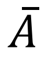
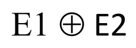
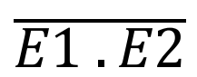
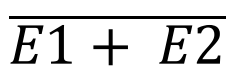
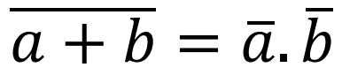
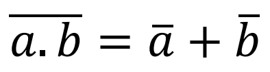
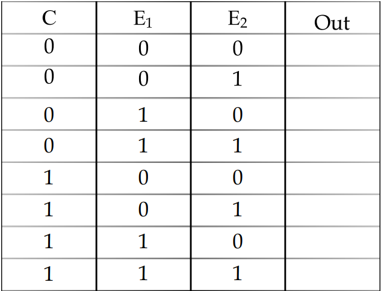
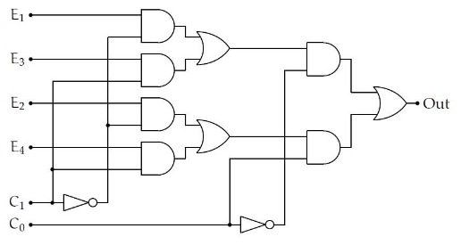
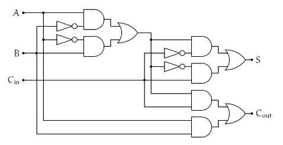

**Table des matières** 

1. [L’algèbre de Boole ](#_page0_x40.00_y375.04)
2. [Les booléens en Python](#booleens_python)
3. [Les fonctions logiques et tables de vérité](#_page1_x40.00_y213.04)
4. [Quelques propriétés](#_page3_x40.00_y448.04)
5. [Exercices](#_page4_x40.00_y43.04)


## **<H2 STYLE="COLOR:BLUE;">1. L’algèbre<a name="_page0_x40.00_y375.04"></a> de Boole</h2>** 

L'**algèbre de Boole** est une branche des mathématiques qui traite des **opérations logiques**. Elle a été développée par **George Boole** (1815-1864) et est largement utilisée en informatique et en électronique numérique.

✅ L’algèbre de Boole repose sur l’ensemble **B = {0, 1}** où :

- `0` représente **FAUX** (état bas).

- `1` représente **VRAI** (état haut).

On y retrouve trois **opérations fondamentales** :


### **<H3 STYLE="COLOR:GREEN;">1.1. ET<a name="_page0_x40.00_y473.04"></a></h3>** 

**Définition** : `a ET b` est VRAI **si et seulement si** `a` ET `b` sont tous deux VRAIS.

✅ Différentes notations :

- `a ⋅ b`

- `a ∧ b`

- `a && b` (langages C, Java, PHP, JavaScript…)

- `a and b` en Python (en **minuscules**)


### **<H3 STYLE="COLOR:GREEN;">1.2. OU<a name="_page0_x40.00_y591.04"></a></h3>** 

**Définition** : `a OU b` est VRAI **si et seulement si** `a` ou `b` (ou les deux) sont VRAIS.

✅ Différentes notations :

- `a + b`

- `a ∨ b`

- `a || b` (langages C, Java, PHP, JavaScript…)

- `a or b` en Python (en **minuscules**)


### **<H3 STYLE="COLOR:GREEN;">1.3. NON<a name="_page1_x40.00_y43.04"></a></h3>** 

**Définition** : `NON a` est VRAI **si et seulement si** `a` est FAUX. On dit aussi que `NON a` est le **complément** de `a`.

✅ Différentes notations :

- `¬a`

- `a̅` (a surmonté d'une barre)

- `!a` (C, Java, JavaScript…)

- `not a` en Python (en **minuscules**)


### **<H3 STYLE="COLOR:GREEN;">1.4. Priorité des opérateurs</h3>** 

Comme en arithmétique (où la multiplication passe avant l'addition), les opérateurs booléens ont un ordre de priorité :

1. **NON** (le plus prioritaire)
2. **ET**
3. **OU** (le moins prioritaire)

Ainsi `A + B ⋅ C` se lit `A + (B ⋅ C)`, et en Python `not a or b and c` se lit `(not a) or (b and c)`.

💡 En cas de doute, **mettre des parenthèses** : c'est plus lisible et cela évite les erreurs.


## **<H2 STYLE="COLOR:BLUE;">2. Les<a name="booleens_python"></a> booléens en Python</h2>** 

### **<H3 STYLE="COLOR:GREEN;">2.1. Le type `bool`</h3>** 

Python possède un type dédié, `bool`, qui n'a que deux valeurs : `True` et `False` (avec une majuscule).

```python
>>> type(True)
<class 'bool'>
>>> 3 < 5
True
>>> 3 == 5
False
```

Les comparaisons (`<`, `<=`, `>`, `>=`, `==`, `!=`) et l'opérateur `in` renvoient un booléen.

🚨 **Attention** : `=` **affecte** une valeur à une variable, `==` **teste** l'égalité et renvoie un booléen.

💡 En Python, `True` vaut `1` et `False` vaut `0` dans un calcul : `True + True` donne `2`. C'est pourquoi on peut écrire les tables de vérité avec des `0` et des `1`.


### **<H3 STYLE="COLOR:GREEN;">2.2. L'évaluation paresseuse (séquentielle)</h3>** 

Python évalue `and` et `or` **de gauche à droite** et **s'arrête dès que le résultat est connu** :

- `a and b` : si `a` est faux, le résultat est forcément faux, donc `b` **n'est pas évalué**.
- `a or b` : si `a` est vrai, le résultat est forcément vrai, donc `b` **n'est pas évalué**.

Cela permet d'écrire des tests qui seraient sinon impossibles :

```python
x = 0
if x != 0 and 10 / x > 2:   # 10 / x n'est jamais calculé : pas d'erreur
    print("grand")
```

Si on inverse les deux conditions (`10 / x > 2 and x != 0`), Python calcule `10 / 0` en premier et lève une `ZeroDivisionError`.

Même idée pour vérifier un indice avant de lire une case :

```python
tab = [4, 8, 15]
i = 5
if i < len(tab) and tab[i] == 15:   # tab[5] n'est jamais lu : pas d'IndexError
    print("trouvé")
```

🚨 **Attention** : avec des nombres, `and` et `or` ne renvoient pas `True`/`False` mais **la dernière valeur évaluée** : `0 or 5` vaut `5`, `3 and 7` vaut `7`, `0 and 7` vaut `0`. Seul `not` renvoie toujours un booléen.

???+ question "Activité 1 : prévoir avant d'exécuter"

    Prévoir ce qu'affiche chaque ligne, **puis** vérifier dans l'éditeur.

    ```python
    print(5 > 3 and 2 > 4)
    print(not (5 > 3))
    print(0 or 5)
    print(3 and 7)
    print(not 1)
    x = 0
    print(x == 0 or 10 / x > 1)
    print(x != 0 and 10 / x > 1)
    ```

    ??? success "Python"
        {{ IDE() }}

    ??? success "Solution"

        `False` · `False` · `5` · `7` · `False` · `True` · `False`

        Les deux dernières lignes ne provoquent **aucune erreur** : la division `10 / x` n'est jamais calculée grâce à l'évaluation paresseuse.


## **<H2 STYLE="COLOR:BLUE;">3. Les<a name="_page1_x40.00_y213.04"></a> fonctions logiques et tables de vérité</h2>** 

L'algèbre de Boole est à la base des **circuits logiques** utilisés dans les ordinateurs.

💡 Un **transistor** fonctionne comme un **interrupteur** :  

- `1` : le courant passe (**état haut**).

- `0` : le courant ne passe pas (**état bas**).

🔹 Types de circuits logiques :

1. **Circuits combinatoires** : la sortie dépend uniquement des entrées.

2. **Circuits séquentiels** : la sortie dépend des entrées et de l’historique des états précédents.

💡 Une **table de vérité** donne la sortie pour **toutes** les combinaisons possibles des entrées : avec `n` entrées, il y a `2ⁿ` lignes (4 lignes pour 2 entrées, 8 pour 3, 16 pour 4). On les écrit dans l'ordre où l'on compte en binaire : `00`, `01`, `10`, `11`…


### **<H3 STYLE="COLOR:GREEN;">3.1. La<a name="_page1_x40.00_y426.04"></a> porte NON (NOT)</h3>** 

| Entrée (`E`) | Sortie (`S`) |
|---|---|
| 0 | 1 |
| 1 | 0 |

✅ **La sortie est l'inverse de l'entrée.**

???+ question "Activité 2"

    ```python
    def NOT(a):
        return not a

    print(NOT(1))  # Affiche False
    print(NOT(0))  # Affiche True
    ```

    `not` renvoie toujours un booléen (`True` ou `False`), même si on lui donne `0` ou `1`.

    ??? success "Python"
        {{ IDE() }}


La porte NON est symbolisée par le schéma suivant : 

|Symbole |Autre symbole |Opération |
| - | - | - |
||||

### **<H3 STYLE="COLOR:GREEN;">3.2. La<a name="_page1_x40.00_y623.04"></a> porte OU (OR)</h3>** 

| `E1` | `E2` | `S` (Sortie) |
|---|---|---|
| 0 | 0 | 0 |
| 0 | 1 | 1 |
| 1 | 0 | 1 |
| 1 | 1 | 1 |

✅ **La sortie est 1 si au moins une des entrées est 1.**

???+ question "Activité 3"

    ```python
    def OR(a, b):
        return a or b

    print(OR(0, 1))  # Affiche 1
    print(OR(0, 0))  # Affiche 0
    ```

    Ici l'affichage est `1` ou `0` (et non `True` ou `False`) car `or` renvoie la dernière valeur évaluée (voir 2.2).

    ??? success "Python"
        {{ IDE() }}


La porte OU est symbolisée par le schéma suivant : 

|Symbole |Autre symbole |Opération |
| - | - | - |
|||E1 + E2 |

### **<H3 STYLE="COLOR:GREEN;">3.3. La<a name="_page2_x40.00_y162.04"></a> porte ET (AND)</h3>** 

| `E1` | `E2` | `S` (Sortie) |
|---|---|---|
| 0 | 0 | 0 |
| 0 | 1 | 0 |
| 1 | 0 | 0 |
| 1 | 1 | 1 |

✅ **La sortie est 1 uniquement si les deux entrées sont 1.**

???+ question "Activité 4"

    ```python
    def AND(a, b):
        return a and b

    print(AND(1, 1))  # Affiche 1
    print(AND(1, 0))  # Affiche 0
    ```

    ??? success "Python"
        {{ IDE() }}


La porte ET est symbolisée par le schéma suivant : 


|Symbole |Autre symbole |Opération |
| - | - | - |
|||E1 . E2 |

### **<H3 STYLE="COLOR:GREEN;">3.4. La<a name="_page2_x40.00_y432.04"></a> porte OU EXCLUSIF (XOR)</h3>** 

| `E1` | `E2` | `S` (Sortie) |
|---|---|---|
| 0 | 0 | 0 |
| 0 | 1 | 1 |
| 1 | 0 | 1 |
| 1 | 1 | 0 |

✅ **La sortie est 1 uniquement si les entrées sont différentes.**

On peut l'écrire avec les trois opérations de base : `E1 ⊕ E2 = E1 ⋅ E2̅ + E1̅ ⋅ E2`.

???+ question "Activité 5"

    ```python
    def XOR(a, b):
        return a ^ b

    print(XOR(1, 1))  # Affiche 0
    print(XOR(1, 0))  # Affiche 1
    ```

    En Python, `^` est le XOR **bit à bit** : il fonctionne avec `0` et `1` (ou `True` et `False`). Pour des booléens, on peut aussi écrire `a != b`.

    ??? success "Python"
        {{ IDE() }}


La porte XOR est symbolisée par le schéma suivant : 

|Symbole |Autre symbole |Opération |
| - | - | - |
||| |

### **<H3 STYLE="COLOR:GREEN;">3.5. La<a name="_page2_x40.00_y649.04"></a> porte NON ET (NAND)</h3>** 

C'est un ET suivi d'un NON : `S = NON (E1 ET E2)`.

Table de vérité

| E1 | E2 | S |
| - | - | - |
| 0  | 0  | 1 |
| 0  | 1  | 1 |
| 1  | 0  | 1 |
| 1  | 1  | 0 |

|Symbole |Opération |
| - | - | 
|| |


### **<H3 STYLE="COLOR:GREEN;">3.6. La porte NON OU (NOR)</h3>** 

C'est un OU suivi d'un NON : `S = NON (E1 OU E2)`.

Table de vérité

| E1 | E2 | S |
|----|----|---|
| 0  | 0  | 1 |
| 0  | 1  | 0 |
| 1  | 0  | 0 |
| 1  | 1  | 0 |


|Symbole  |Opération |
| - | - | 
|| |

💡 Les portes NAND et NOR sont dites **universelles** : avec des portes NAND seulement (ou NOR seulement), on peut construire toutes les autres.


???+ question "Activité n°6 : Complétons les tables de vérité"

    Écrire les tables de vérité des expressions suivantes :

    1. **A ⋅ B̅**  
    2. **A + B ⋅ C**  (attention à la priorité : le ET passe avant le OU)
    3. **A ⋅ B + (C ⊕ D)**  

    ??? success "Solution"

        **Table de vérité pour A ⋅ B̅ :**

        | A | B | B̅ | A ⋅ B̅ |
        |---|---|---|------|
        | 0 | 0 | 1 | 0    |
        | 0 | 1 | 0 | 0    |
        | 1 | 0 | 1 | 1    |
        | 1 | 1 | 0 | 0    |

        **Table de vérité pour A + B ⋅ C :**

        | A | B | C | B ⋅ C | A + (B ⋅ C) |
        |---|---|---|-------|------------|
        | 0 | 0 | 0 | 0     | 0          |
        | 0 | 0 | 1 | 0     | 0          |
        | 0 | 1 | 0 | 0     | 0          |
        | 0 | 1 | 1 | 1     | 1          |
        | 1 | 0 | 0 | 0     | 1          |
        | 1 | 0 | 1 | 0     | 1          |
        | 1 | 1 | 0 | 0     | 1          |
        | 1 | 1 | 1 | 1     | 1          |

        **Table de vérité pour A ⋅ B + (C ⊕ D) :**

        | A | B | C | D | C ⊕ D | A ⋅ B | A ⋅ B + (C ⊕ D) |
        |---|---|---|---|-------|-----|----------------|
        | 0 | 0 | 0 | 0 | 0     | 0   | 0              |
        | 0 | 0 | 0 | 1 | 1     | 0   | 1              |
        | 0 | 0 | 1 | 0 | 1     | 0   | 1              |
        | 0 | 0 | 1 | 1 | 0     | 0   | 0              |
        | 0 | 1 | 0 | 0 | 0     | 0   | 0              |
        | 0 | 1 | 0 | 1 | 1     | 0   | 1              |
        | 0 | 1 | 1 | 0 | 1     | 0   | 1              |
        | 0 | 1 | 1 | 1 | 0     | 0   | 0              |
        | 1 | 0 | 0 | 0 | 0     | 0   | 0              |
        | 1 | 0 | 0 | 1 | 1     | 0   | 1              |
        | 1 | 0 | 1 | 0 | 1     | 0   | 1              |
        | 1 | 0 | 1 | 1 | 0     | 0   | 0              |
        | 1 | 1 | 0 | 0 | 0     | 1   | 1              |
        | 1 | 1 | 0 | 1 | 1     | 1   | 1              |
        | 1 | 1 | 1 | 0 | 1     | 1   | 1              |
        | 1 | 1 | 1 | 1 | 0     | 1   | 1              |

???+ question "Activité n°7 : faire écrire la table de vérité par Python"

    Une double boucle parcourt toutes les combinaisons de deux entrées, dans l'ordre binaire.

    ```python
    def table_xor():
        print("a b | a xor b")
        for a in (0, 1):
            for b in (0, 1):
                s = int(a != b)
                print(a, b, "|", s)

    table_xor()
    ```

    1. Exécuter le programme et comparer avec la table de la porte XOR.
    2. Écrire une fonction `table_A_ou_B_et_C()` qui affiche la table de `A + B ⋅ C` (trois boucles imbriquées) et vérifier la solution de l'activité n°6.

    ??? success "Python"
        {{ IDE() }}

    ??? success "Solution"

        ```python
        def table_A_ou_B_et_C():
            print("A B C | A + B.C")
            for A in (0, 1):
                for B in (0, 1):
                    for C in (0, 1):
                        s = int(A or (B and C))
                        print(A, B, C, "|", s)
        ```

        `int(...)` convertit le résultat en `0` ou `1` pour obtenir un affichage homogène.


???+ question "Activité n°8 : Compléter le tableau de vérité"

    Voici un exemple de fonction booléenne : La fonction multiplexeur, notée `mux`.

    La formule est donnée par :
    `mux(x, y, z) = (not(x) and y) or (x and z)`

    **1.** Compléter le tableau suivant :

    | x | y | z | not(x) | not(x) and y | x and z | mux(x,y,z) |
    |---|---|---|--------|--------------|---------|------------|
    | 0 | 0 | 0 |        |              |         |            |
    | 0 | 0 | 1 |        |              |         |            |
    | 0 | 1 | 0 |        |              |         |            |
    | 0 | 1 | 1 |        |              |         |            |
    | 1 | 0 | 0 |        |              |         |            |
    | 1 | 0 | 1 |        |              |         |            |
    | 1 | 1 | 0 |        |              |         |            |
    | 1 | 1 | 1 |        |              |         |            |

    ??? success "Solution"

        **Table complétée :**

        | x | y | z | not(x) | not(x) and y | x and z | mux(x,y,z) |
        |---|---|---|--------|--------------|---------|------------|
        | 0 | 0 | 0 | 1      | 0            | 0       | 0          |
        | 0 | 0 | 1 | 1      | 0            | 0       | 0          |
        | 0 | 1 | 0 | 1      | 1            | 0       | 1          |
        | 0 | 1 | 1 | 1      | 1            | 0       | 1          |
        | 1 | 0 | 0 | 0      | 0            | 0       | 0          |
        | 1 | 0 | 1 | 0      | 0            | 1       | 1          |
        | 1 | 1 | 0 | 0      | 0            | 0       | 0          |
        | 1 | 1 | 1 | 0      | 0            | 1       | 1          |

        On remarque que **si x = 0, mux recopie y** et **si x = 1, mux recopie z** : x joue le rôle d'un aiguillage.
    
    **2.** Montrer que `(x and y) = not (not(x) or not(y))`  

    ??? success "Solution"

        On construit la table de vérité des deux membres et on constate que les colonnes sont identiques :

        | x | y | x and y | not(x) | not(y) | not(x) or not(y) | not (not(x) or not(y)) |
        |---|---|---|---|---|---|---|
        | 0 | 0 | 0 | 1 | 1 | 1 | 0 |
        | 0 | 1 | 0 | 1 | 0 | 1 | 0 |
        | 1 | 0 | 0 | 0 | 1 | 1 | 0 |
        | 1 | 1 | 1 | 0 | 0 | 0 | 1 |

        C'est une conséquence des **lois de De Morgan** (voir 4.5).
    
    **3.** Montrer que `(x or y) = not (not(x) and not(y))`  

    ??? success "Solution"

        | x | y | x or y | not(x) and not(y) | not (not(x) and not(y)) |
        |---|---|---|---|---|
        | 0 | 0 | 0 | 1 | 0 |
        | 0 | 1 | 1 | 0 | 1 |
        | 1 | 0 | 1 | 0 | 1 |
        | 1 | 1 | 1 | 0 | 1 |

        Les colonnes `x or y` et `not (not(x) and not(y))` sont identiques : c'est encore une loi de **De Morgan**.
    
    **4.** Trouver l’expression de la fonction `ssi(x, y)` (« si et seulement si », qui vaut 1 quand x et y ont la même valeur) à l’aide des opérateurs booléens.

    ??? success "Solution"

        La fonction `ssi(x,y)` vaut 1 quand x et y valent tous les deux 1, **ou** tous les deux 0 :

        `ssi(x, y) = (x and y) or (not(x) and not(y))`

        **Table de vérité de `ssi(x,y)` :**

        | x | y | ssi(x,y) |
        |---|---|----------|
        | 0 | 0 | 1        |
        | 0 | 1 | 0        |
        | 1 | 0 | 0        |
        | 1 | 1 | 1        |

        C'est le contraire du XOR : `ssi(x, y) = not (x xor y)`.


## **<H2 STYLE="COLOR:BLUE;">4. Quelques<a name="_page3_x40.00_y448.04"></a> propriétés</h2>** 
### **<H3 STYLE="COLOR:GREEN;">4.1. Associativité</h3>**

Certaines parenthèses peuvent être omises :

- `(a + b) + c = a + (b + c) = a + b + c`

- `(a ⋅ b) ⋅ c = a ⋅ (b ⋅ c) = a ⋅ b ⋅ c`


### **<H3 STYLE="COLOR:GREEN;">4.2. Commutativité<a name="_page3_x40.00_y528.04"></a></H3>** 

L'ordre des opérandes **n'a pas d'importance** :

- `a + b = b + a`

- `a ⋅ b = b ⋅ a`

🚨 **Attention** : en Python, à cause de l'évaluation paresseuse, `a and b` et `b and a` donnent le même résultat logique mais **ne s'exécutent pas pareil** (voir 2.2 : `x != 0 and 10 / x > 2` fonctionne, l'inverse plante).


### **<H3 STYLE="COLOR:GREEN;">4.3. Distributivité<a name="_page3_x40.00_y585.04"></a></h3>** 

Le ET se distribue sur le OU, **comme la multiplication sur l'addition** :

- `a ⋅ (b + c) = (a ⋅ b) + (a ⋅ c)`

Le OU se distribue aussi sur le ET, ce qui **n'a pas d'équivalent en arithmétique** :

- `a + (b ⋅ c) = (a + b) ⋅ (a + c)`

🚨 **Attention** : en arithmétique, `2 + 3 × 4` n'est pas égal à `(2 + 3) × (2 + 4)`, alors qu'en algèbre de Boole, cette égalité est toujours vraie.


### **<H3 STYLE="COLOR:GREEN;">4.4. Éléments neutres, absorbants et complément</h3>** 

| Propriété | Avec OU (`+`) | Avec ET (`⋅`) |
|---|---|---|
| Élément neutre | `a + 0 = a` | `a ⋅ 1 = a` |
| Élément absorbant | `a + 1 = 1` | `a ⋅ 0 = 0` |
| Idempotence | `a + a = a` | `a ⋅ a = a` |
| Complément | `a + a̅ = 1` | `a ⋅ a̅ = 0` |

Et la double négation : `NON (NON a) = a`.

💡 Ces règles permettent de **simplifier** une expression. Exemple : `A + B + B ⋅ C = A + B ⋅ (1 + C) = A + B ⋅ 1 = A + B`.


### **<H3 STYLE="COLOR:GREEN;">4.5. Lois<a name="_page3_x40.00_y649.04"></a> de De Morgan</h3>**[^1] 


Le complément d’une somme logique est égal au produit logique des termes complémentés :

  

Le complément d’un produit logique est égal à la somme logique des termes complémentés :



En Python : `not (a or b) == (not a and not b)` et `not (a and b) == (not a or not b)`.

✅ **Les lois de De Morgan permettent de transformer un ET en OU (et inversement) en complémentant les termes.**

???+ question "Activité 9 : vérifier les lois de De Morgan avec Python"

    ```python
    def de_morgan_1(a, b):
        return (not (a or b)) == (not a and not b)

    def de_morgan_2(a, b):
        return (not (a and b)) == (not a or not b)

    for a in (False, True):
        for b in (False, True):
            print(a, b, de_morgan_1(a, b), de_morgan_2(a, b))
    ```

    1. Exécuter le programme : les deux lois sont-elles vraies pour toutes les combinaisons ?
    2. Retirer les parenthèses autour de `not (a or b)` dans `de_morgan_1` et réexécuter. Le résultat est toujours `True`… mais pour une mauvaise raison ! Pourquoi ?

    ??? success "Python"
        {{ IDE() }}

    ??? success "Solution"

        1. Oui, la fonction renvoie `True` pour les quatre combinaisons : les lois sont vérifiées sur **toute** la table de vérité.
        2. `not` est **moins prioritaire** que `==`. Sans parenthèses, Python lit `not ((a or b) == (not a and not b))`. Or `a or b` et `not a and not b` sont toujours contraires, donc la comparaison vaut toujours `False`, et `not False` donne `True`. Le programme « marche » par hasard : il ne vérifie plus du tout la loi de De Morgan.

## **<H2 STYLE="COLOR:BLUE;">5. Exercices<a name="_page4_x40.00_y43.04"></a></h2>** 

=> **CAPYTALE Le code vous sera donné par votre enseignant**


!!! abstract "Exercice n°1 ★" 
    
    On considère le circuit logique suivant. 

    

    1. Réaliser le circuit. 
    2. Donner l’expression booléenne de S en fonction des variables A et B. 
    3. Compléter la table de vérité ci-dessous. 

        

    4. Par quel circuit comprenant seulement deux portes peut-on remplacer le circuit étudié ? 

!!! abstract "Exercice n°2 ★" 

    On considère le circuit logique ci-dessous. 

    

    1. Donner l’expression booléenne de S en fonction des variables A, B et C. 
    2. Compléter la table de vérité ci-dessous. 

        

    3. En déduire une formule pour S qui ne dépend que des variables A et B. 

!!! abstract "Exercice n°3 ★"

    On considère les circuits logiques ci-dessous. 

    

    1. Donner les expressions booléennes de U et V en fonction des variables A, B et C. 
    2. Compléter les tables de vérité ci-dessous. 

        

    3. Les expressions booléennes U et V sont-elles équivalentes ? 

!!! abstract "Exercice n°4 ★ (circuit MUX-2)"

    On considère le circuit logique suivant.

    

    1. Donner l’expression de Out en fonction de C, E1 et E2. 
    2. Compléter la table de vérité de ce circuit. 

         

    Le circuit étudié est appelé multiplexeur à 2 entrées. Selon la valeur de la commande (C), il permet de reproduire en sortie (Out) : 

    - le signal E1 si C est à 0 ; 
    - le signal E2 si C est à 1. 

    **3.** Vérifier ce fonctionnement sur la table de vérité. Quel lien avec la fonction `mux` de l'activité n°8 ?

!!! abstract "Exercice n°5 ★★ (circuit MUX-4)" 

    On considère un multiplexeur à 4 entrées, dont le circuit est représenté ci-dessous.  

    

    1. Par analyse du circuit, déterminer l’expression booléenne de Out en fonction des entrées E1, E2, E3, E4 et des commandes C0 et C1. 
    2. Quelles sont les valeurs des commandes C0 et C1 qui permettent de sélectionner en sortie (Out) : 

        - l’entrée E1 ? 
        - l’entrée E2 ? 
        - l’entrée E3 ? 
        - l’entrée E4 ? 

!!! abstract "Exercice n°6 ★★ (Half adder)" 

    Le circuit étudié, appelé demi-additionneur, permet d’additionner deux bits A et B. Il comporte deux sorties C et S qui représentent deux expressions booléennes.  

    

    1. Donner les expressions booléennes de C et S en fonction de A et B.  
    2. Compléter la table de vérité de C et S. 

         

    3. Quel est le rôle des sorties C et S dans la fonction du circuit ? On pourra comparer avec l'addition binaire `1 + 1 = 10` vue au chapitre 04.

    Le choix de la lettre C vient du fait qu’en anglais, « retenue » se dit « carry ».  

!!! abstract "Exercice n°7 ★★ (Full adder)" 

    Le circuit étudié dans cet exercice permet d’additionner deux bits A et B en tenant compte d’une retenue d'entrée Cin. Il produit la somme S et une retenue de sortie Cout. 

    

    1. Réaliser ce circuit et compléter la table de vérité ci-dessous. 

        

    2. Vérifier sur deux lignes de la table que `Cout S` (lu comme un nombre binaire) est bien la somme `Cin + A + B`.

!!! abstract "Exercice n°8 ★★" 

    Soit le circuit ci-dessous : 

    

    1. Écrivez l'équation de ce circuit. 
    2. Établissez la table de vérité de ce circuit. 

!!! abstract "Exercice n°9 ★★★"

    Un pont peut supporter 10 tonnes au maximum. La route menant au pont est strictement interdite aux véhicules de plus de 10 tonnes. À chaque extrémité du pont se trouve une barrière et une bascule pour mesurer le poids (a ou b) des véhicules. 

    

    Si un seul véhicule attend devant le pont, la barrière devant lui (A ou B) s'ouvre (étape initiale). Sinon : 

    - si a + b ≤ 10 tonnes, les barrières A et B s'ouvrent ; 
    - si a + b > 10 tonnes, seule la barrière correspondant au véhicule le plus léger s'ouvre ; 
    - si a = b, la barrière A s'ouvre en priorité. 

    L'autre véhicule attend que le premier ait franchi le pont, puis le protocole d'ouverture des barrières recommence à l'étape initiale. 

    Indication : a et b n'étant pas des variables binaires, il convient de créer deux variables binaires x et y et de reformuler l'énoncé du problème. 

    Aide : on posera `x = (a + b <= 10)` et `y = (a > b)`. 

    1. Écrivez la table de vérité pour l'ouverture des barrières A et B (cas où deux véhicules attendent). 
    2. Donnez les équations logiques pour l'ouverture de la barrière A, puis pour l’ouverture de la barrière B. 
    3. Dessinez le circuit logique déterminant l'ouverture des barrières. 


[^1]: Augustus De Morgan (1806-1871) : logicien et mathématicien britannique. 
